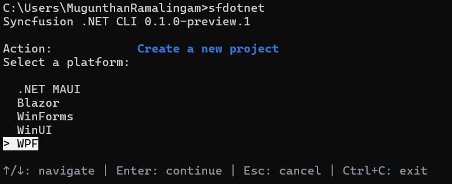
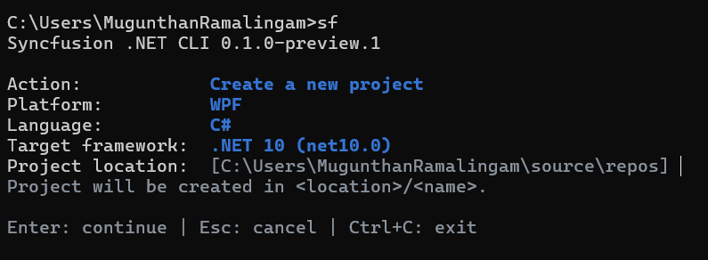
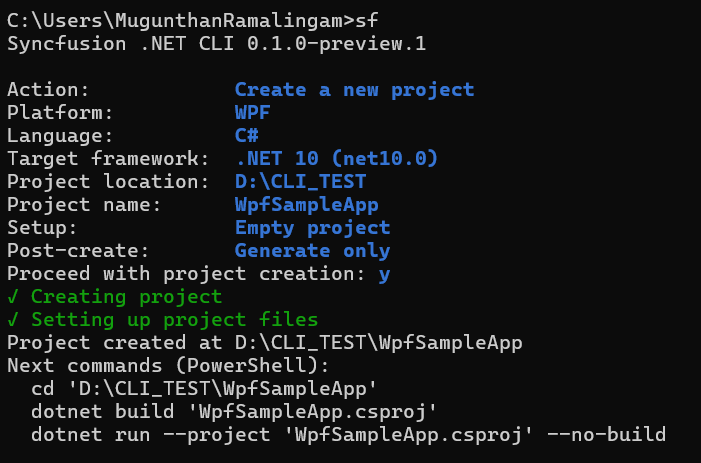

# Create a WPF project

You can create a WPF project through the interactive wizard or a direct command. For CLI installation and the main menu, refer to the [overview](/wpf/dotnet-cli/overview).

## Create a project using the interactive wizard

Run `sf new`, or select **Create a new project** from the main menu. The WPF creation flow is:

1. **Platform:** Select **WPF**.
2. **Language:** Select **C#** or **VB**. C# is the default for direct commands.
3. **Target framework:** Select the .NET version.

    * .NET 10 (`net10.0`), the default
    * .NET 9 (`net9.0`)
    * .NET 8 (`net8.0`)
    * .NET Framework 4.8 (`net48`)
    * .NET Framework 4.7 (`net47`)
    * .NET Framework 4.6.2 (`net462`)

4. **Project location and name:** Enter the parent directory and the project name. The default locations are `%USERPROFILE%\source\repos` on Windows and `~/Projects` on Linux and macOS. The suggested name is `SyncfusionWpfApp`, and the first available numeric suffix is used when the destination name collides.

    

5. **Setup:** Select **Empty project** or **Project with Syncfusion controls**.

6. **Controls:** When you include controls, choose one or more controls from the following list. Use the arrow keys to navigate, Space to toggle, and Enter to continue. At least one selection is required.

    | Control | Control ID |
    | --- | --- |
    | AI AssistView | `ai-assist-view` |
    | Chart | `chart` |
    | DataGrid | `datagrid` |
    | Diagram | `diagram` |
    | DockingManager | `docking-manager` |
    | Gantt | `gantt` |
    | Kanban | `kanban` |
    | NavigationDrawer | `navigation-drawer` |
    | Ribbon | `ribbon` |
    | Scheduler | `scheduler` |
    | TreeGrid | `treegrid` |

7. **Theme:** When the project includes controls, select one of the Syncfusion themes:

    | Theme | Option value |
    | --- | --- |
    | Windows11 (Light) | `Windows11Light` |
    | Windows11 (Dark) | `Windows11Dark` |
    | Material3 (Light) | `Material3Light` |
    | Material3 (Dark) | `Material3Dark` |
    | Office2019 (Colorful) | `Office2019Colorful` |

    The theme applies to the generated app through [SkinManager](https://help.syncfusion.com/wpf/themes/skin-manager). An empty project uses the `Windows11Light` default without prompting.

    

8. **Post-create:** Select **Generate only** or **Build project**.
9. **Confirmation:** Review the selected values and confirm to create the project.

N> A complete direct command does not open the wizard. When a name is missing in an interactive terminal, the wizard supplies a default and collects the remaining unspecified inputs. Missing required values in scripts produce an error.

## Create a project using direct commands

To create a blank project without the wizard:




sf new wpf --name MyApp




To create a project containing Syncfusion&reg; control samples:




sf new wpf --name MyApp --control datagrid
sf new wpf --name MyApp --control datagrid scheduler
sf new wpf --name ReportsVB --language VB --target-framework net48
sf new wpf --name Reports --language C# --target-framework net10.0 --theme Windows11Dark --control chart --control datagrid --post-action build




A generated project places each control sample in a `TabControl` tab with a Welcome page. The [SkinManager](https://help.syncfusion.com/wpf/themes/skin-manager) applies the selected theme through `SfSkinManager.SetTheme`.

N> Neither `--force` nor confirmation authorizes overwriting an existing project destination.

## Run the created project

On Windows, build and run the generated project:




dotnet run --project ./MyApp/MyApp.csproj




On Linux and macOS, use `--post-action generate` when creating the project. The CLI explains that building and running WPF applications requires a supported Windows environment, and file generation remains available.

N> Modern WPF projects (`net8.0` and later) use `EnableWindowsTargeting`, so restore works on other hosts, but building and launching require Windows. .NET Framework projects (`net462`, `net47`, `net48`) require Visual Studio MSBuild with the .NET desktop workload.

## Creation options

| Option | Description |
| --- | --- |
| `-n`, `--name` | Project name. Required when prompting is unavailable |
| `-p`, `--path` | Parent directory. Defaults to the current directory |
| `-t`, `--target-framework` | The .NET target framework, such as `net10.0` or `net48` |
| `--language` | Project language: `C#` or `VB`. Defaults to C# |
| `--theme` | The Syncfusion theme, such as `Windows11Dark`. Defaults to `Windows11Light` |
| `--control` | One or more control IDs from step 6, or `empty`. Omit to create an empty project |
| `--post-action` | Post-create action: `generate` or `build`. Defaults to `build` for direct commands |
| `--dry-run` | Preview the action without making changes |
| `--force` | Allow supported overwrites. Edited control samples remain protected |
| `--no-restore` | Skip `dotnet restore` after the action |
| `--no-build` | Skip `dotnet build` after the action |
| `--no-interactive` | Disable interactive prompts |
| `--json` | Emit a JSON document instead of table output |

## FAQs

**Does `sf add wpf datagrid` generate the DataGrid sample?**

In a CLI-generated project, yes. In an ordinary project, the command adds the NuGet package reference only, and the CLI reports that no sample was generated. For details, refer to [Manage packages](/wpf/dotnet-cli/manage-packages).

**Which .NET versions are supported?**

.NET 10 (`net10.0`), .NET 9 (`net9.0`), .NET 8 (`net8.0`), .NET Framework 4.8 (`net48`), .NET Framework 4.7 (`net47`), and .NET Framework 4.6.2 (`net462`).

**Can I add more controls after the project is created?**

Yes. Run `sf new wpf --control <control-id>` again with the additional control IDs, or use `sf add wpf --control <control-id>` in the generated project to add the package and integrate the matching sample.

## See also

* [Manage packages](/wpf/dotnet-cli/manage-packages)
* [License activation](/wpf/dotnet-cli/licensing)
* [MCP configuration](/wpf/dotnet-cli/configure-mcp)
* [AI skills installation](/wpf/dotnet-cli/install-skills)
