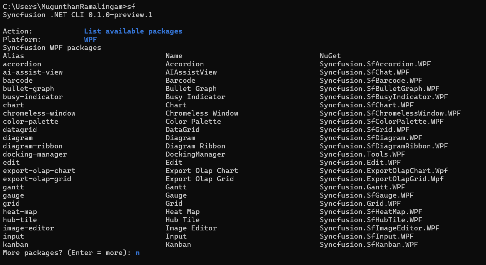

# Overview of the Syncfusion® .NET CLI for WPF

The Syncfusion<sup style="font-size:70%">&reg;</sup> .NET CLI (`sf`) is a cross-platform command line tool that creates WPF projects and manages Syncfusion<sup style="font-size:70%">&reg;</sup> WPF NuGet packages from a terminal. After you install the CLI, you can run `sf` with no arguments to open an interactive menu, or run a direct command such as `sf new wpf` for scripted, prompt-free creation.

N> The Syncfusion<sup style="font-size:70%">&reg;</sup> .NET CLI is currently in preview and is installed with the `--prerelease` flag.

You can use the CLI to perform the following actions:

* Create a blank WPF app, or an app containing generated Syncfusion<sup style="font-size:70%">&reg;</sup> control samples.
* Add or update Syncfusion<sup style="font-size:70%">&reg;</sup> WPF NuGet package references in an existing project.
* List available and installed packages, and search the package catalog.
* Apply a Syncfusion theme such as Windows11 (Light) or Material3 (Dark) to a new project.

This documentation covers the WPF platform.

## Prerequisites

The following software is required before you install and use the CLI:

* [.NET SDK](https://dotnet.microsoft.com/download). The SDK selected through `PATH` takes precedence, with the running .NET installation as a fallback.
* On Windows, the **.NET desktop development** workload for building and running WPF applications. On Linux and macOS, use `--post-action generate` for portable source generation.
* An internet connection so package operations can reach [nuget.org](https://www.nuget.org).

N> Syncfusion<sup style="font-size:70%">&reg;</sup> packages resolve from the official nuget.org feed, `https://api.nuget.org/v3/index.json`. The CLI accepts only this source through `--source`.

## Installation

The CLI is published as a .NET global tool with the package ID `Syncfusion.DotNet.CLI`.

1. Open a terminal and run the following command. Add `--prerelease` while only preview versions are available.

    ```bash
    dotnet tool install -g Syncfusion.DotNet.CLI --prerelease
    ```

2. Verify the installation and print the CLI version.

    ```bash
    sf --version
    ```

To update the tool to the latest release, run:

```bash
dotnet tool update -g Syncfusion.DotNet.CLI --prerelease
```

To remove the tool, run:

```bash
dotnet tool uninstall -g Syncfusion.DotNet.CLI
```

## Initialize the CLI

Run `sf` in an interactive terminal to open the main menu. The menu shows the current CLI version and groups the available operations.


| Group | Operation | Command reference |
| --- | --- | --- |
| Project creation | Create a new project | `sf new` |
| Package management | Add a package to an existing project | `sf add` |
| Package management | Update a package in an existing project | `sf update` |
| Discovery | List available packages | `sf list <platform> packages` |
| Discovery | List installed packages in an existing project | `sf list <platform> installed` |
| Discovery | Search for packages | `sf search` |
| Help and information | View CLI information | `sf info` |
| Help and information | Show help | `sf help` |

N> The `<platform>` text is a usage placeholder. Use `wpf` for WPF.

Use the following keys to navigate the interactive screens:

| Key | Action |
| --- | --- |
| Up / Down | Move through the options |
| Enter | Choose the focused option, or continue |
| Space | Toggle a checkbox in a multi-selection list |
| Escape | Cancel the current question and return to the menu |
| `Ctrl+C` | Exit the interactive session |

Complete direct commands remain usable without opening the menu. `--no-interactive` disables prompts in any command.

## Available commands

| Command | Purpose |
| --- | --- |
| `sf new wpf` | Create a new WPF project |
| `sf add wpf <package>` | Add a Syncfusion<sup style="font-size:70%">&reg;</sup> package to an existing project |
| `sf update wpf <package>` | Update a package in an existing project |
| `sf list wpf packages` | List available packages |
| `sf list wpf installed` | List installed packages in an existing project |
| `sf search <text> --framework wpf` | Search the WPF package catalog |
| `sf info` | Show CLI information |
| `sf help wpf` | Show the WPF command map |
| `sf --version` | Show the CLI version |

## Create a WPF project

You can create a WPF project through the interactive wizard or a direct command.

### Create a project using the interactive wizard

Run `sf new`, or select **Create a new project** from the main menu. The WPF creation flow is:

1. **Platform:** Select **WPF**.
2. **Language:** Select **C#** or **VB**. C# is the default for direct commands.
3. **Target framework:** Select the .NET version.

    * .NET 10 (`net10.0`), the default
    * .NET 9 (`net9.0`)
    * .NET 8 (`net8.0`)
    * .NET Framework 4.8 (`net48`)
    * .NET Framework 4.7 (`net47`)
    * .NET Framework 4.6.2 (`net462`)

4. **Project location and name:** Enter the parent directory and the project name. The default locations are `%USERPROFILE%\source\repos` on Windows and `~/Projects` on Linux and macOS. The suggested name is `SyncfusionWpfApp`, and the first available numeric suffix is used when the destination name collides.

    

5. **Setup:** Select **Empty project** or **Project with Syncfusion controls**.

6. **Controls:** When you include controls, choose one or more controls from the list. Use the arrow keys to navigate, Space to toggle, and Enter to continue. At least one selection is required.

7. **Theme:** When the project includes controls, select one of the Syncfusion themes:

    | Theme | Option value |
    | --- | --- |
    | Windows11 (Light) | `Windows11Light` |
    | Windows11 (Dark) | `Windows11Dark` |
    | Material3 (Light) | `Material3Light` |
    | Material3 (Dark) | `Material3Dark` |
    | Office2019 (Colorful) | `Office2019Colorful` |

    The theme applies to the generated app through [SkinManager](https://help.syncfusion.com/wpf/themes/skin-manager). An empty project uses the `Windows11Light` default without prompting.

    

8. **Post-create:** Select **Generate only** or **Build project**.
9. **Confirmation:** Review the selected values and confirm to create the project.

N> A complete direct command does not open the wizard. When a name is missing in an interactive terminal, the wizard supplies a default and collects the remaining unspecified inputs. Missing required values in scripts produce an error.

### Available controls

The following controls are available in a new WPF project:

| Control | Control ID |
| --- | --- |
| AI AssistView | `ai-assist-view` |
| Chart | `chart` |
| DataGrid | `datagrid` |
| Diagram | `diagram` |
| DockingManager | `docking-manager` |
| Gantt | `gantt` |
| Kanban | `kanban` |
| NavigationDrawer | `navigation-drawer` |
| Ribbon | `ribbon` |
| Scheduler | `scheduler` |
| TreeGrid | `treegrid` |

### Create a project using direct commands

To create a blank project without the wizard:

```bash
sf new wpf --name MyApp
```

To create a project containing Syncfusion<sup style="font-size:70%">&reg;</sup> control samples:

```bash
sf new wpf --name MyApp --control datagrid
sf new wpf --name MyApp --control datagrid scheduler
sf new wpf --name ReportsVB --language VB --target-framework net48
sf new wpf --name Reports --language C# --target-framework net10.0 --theme Windows11Dark --control chart --control datagrid --post-action build
```

A generated project places each control sample in a `TabControl` tab with a Welcome page. The [SkinManager](https://help.syncfusion.com/wpf/themes/skin-manager) applies the selected theme through `SfSkinManager.SetTheme`.


N> A complete direct command does not open the wizard. Neither `--force` nor confirmation authorizes overwriting an existing project destination.

## Run the created project

On Windows, build and run the generated project:

```bash
dotnet run --project ./MyApp/MyApp.csproj
```

On Linux and macOS, use `--post-action generate` when creating the project. The CLI explains that building and running WPF applications requires a supported Windows environment, and file generation remains available.

N> Modern WPF projects (`net8.0` and later) use `EnableWindowsTargeting`, so restore works on other hosts, but building and launching require Windows. .NET Framework projects (`net462`, `net47`, `net48`) require Visual Studio MSBuild with the .NET desktop workload.

## Manage packages in an existing project

Package operations change NuGet references only. They do not generate control files.

`<package>` accepts a canonical package alias, a canonical package ID, or an exact unambiguous package display name:

```bash
sf add wpf datagrid
sf add wpf Syncfusion.SfGrid.WPF
sf update wpf chart --path ./MyApp --version 35.1.40
```

To list the available WPF packages:

```bash
sf list wpf packages
```



To list the installed packages in an existing project, and to search the catalog:

```bash
sf list wpf installed --path ./MyApp
sf search chart --framework wpf
```

Existing-project commands accept `-p/--path` with a project file, a project directory, or a supported subdirectory. Discovery stops at the nearest project or repository boundary. `--json` emits one JSON document for script use. Use `--details` or `--verbose` to see package descriptions and whether a generated sample is available.

## Help

To show the concise command map and the WPF command map:

```bash
sf help
sf help wpf
```


## Options reference

### Creation options

| Option | Description |
| --- | --- |
| `-n`, `--name` | Project name. Required when prompting is unavailable |
| `-p`, `--path` | Parent directory. Defaults to the current directory |
| `-t`, `--target-framework` | The .NET target framework, such as `net10.0` or `net48` |
| `--language` | Project language: `C#` or `VB`. Defaults to C# |
| `--theme` | The Syncfusion theme, such as `Windows11Dark`. Defaults to `Windows11Light` |
| `--control` | One or more control IDs, or `empty`. Omit to create an empty project |
| `--post-action` | Post-create action: `generate` or `build`. Defaults to `build` for direct commands |
| `--dry-run` | Preview the action without making changes |
| `--force` | Allow supported overwrites. Edited control samples remain protected |
| `--no-restore` | Skip `dotnet restore` after the action |
| `--no-build` | Skip `dotnet build` after the action |
| `--no-interactive` | Disable interactive prompts |
| `--json` | Emit a JSON document instead of table output |

N> `--post-action build` conflicts with `--no-build`. Failed creation, restore, or build rolls back the owned project directory.

### Package operation options

| Option | Description |
| --- | --- |
| `-p`, `--path` | The project directory, `.csproj` file, or a supported subdirectory |
| `-v`, `--version` | The Syncfusion<sup style="font-size:70%">&reg;</sup> NuGet package version |
| `--source` | Package source; Syncfusion<sup style="font-size:70%">&reg;</sup> packages require `https://api.nuget.org/v3/index.json` |
| `--configfile` | The NuGet configuration file to use |
| `--dry-run` | Preview the action without making changes |
| `--force` | Allow supported overwrites |
| `--no-restore` | Skip `dotnet restore` after the action |
| `--json` | Emit one JSON document |

## FAQs

**Does the CLI generate a license key?** No. Syncfusion<sup style="font-size:70%">&reg;</sup> licensing requirements continue to apply. Refer to the [licensing overview](https://help.syncfusion.com/wpf/licensing/overview) to generate and register a license key in your project. Generated projects read the `SYNCFUSION_LICENSE_KEY` environment variable at startup when it is set.

**Does `sf add wpf datagrid` generate the DataGrid sample?** In a CLI-generated project, yes. In an ordinary project, the command adds the NuGet package reference only and reports that no sample was generated.

**Which .NET versions are supported?** .NET 10 (`net10.0`), .NET 9 (`net9.0`), .NET 8 (`net8.0`), .NET Framework 4.8 (`net48`), 4.7 (`net47`), and 4.6.2 (`net462`).

**Which platforms does the CLI support?** .NET MAUI, Blazor, WPF, WinForms, and WinUI 3. This documentation covers WPF.

## See also

* [Syncfusion WPF controls](https://www.syncfusion.com/wpf-ui-controls)
* [WPF system requirements](https://help.syncfusion.com/wpf/system-requirements)
* [Installing WPF NuGet packages](https://help.syncfusion.com/wpf/installation/install-nuget-packages)
* [SkinManager theme overview](https://help.syncfusion.com/wpf/themes/skin-manager)
* [WPF licensing overview](https://help.syncfusion.com/wpf/licensing/overview)