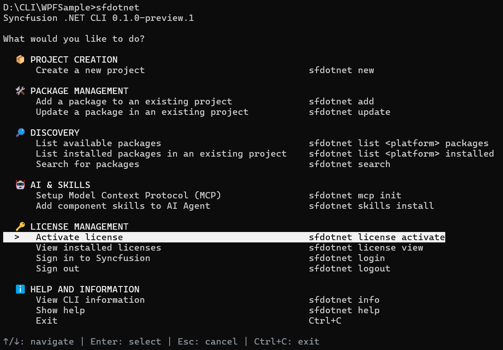
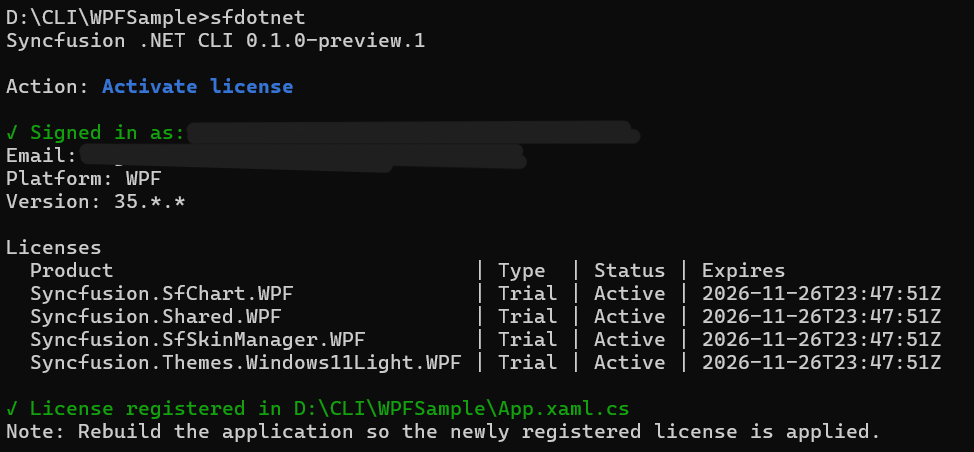
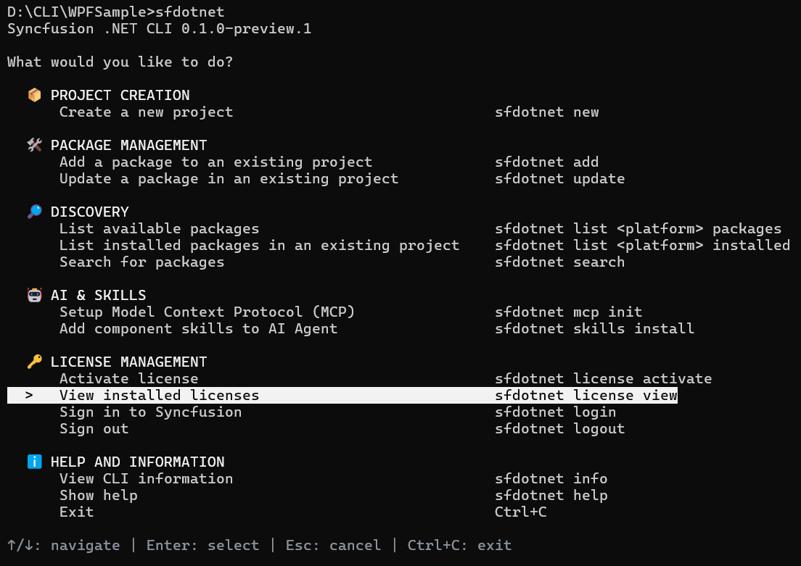
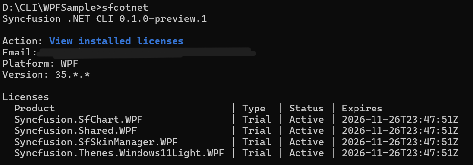

# Activate Syncfusion® licenses

The CLI detects the Syncfusion&reg; controls used in a project, downloads the matching license keys from your Syncfusion&reg; account, and registers the keys in the project's startup code (`App.xaml.cs`). The build then runs without a license warning.

N> Open the Command Prompt or Terminal in the target sample's project directory before running the license activation command. The license operation is project-specific, and the command path must point to the intended sample.

## Activate a license through the interactive menu

1. Open the Command Prompt or Terminal in the target sample's project directory.

    
    

    cd %USERPROFILE%\source\repos\MyApp

    
    

2. Run `sfdotnet` to open the main menu.

    
    

    sfdotnet

    
    

3. Under **License management**, select **Activate license**. The CLI focuses the **Activate License** entry and shows the navigation hint at the bottom of the screen.

    

4. If you are not signed in, the CLI opens your default browser to the Syncfusion&reg; sign-in page. Complete sign in with your Syncfusion&reg; account.

    

5. After sign in, the CLI checks your entitlements, downloads the matching keys for the Syncfusion&reg; controls in the sample, and registers the keys in `App.xaml.cs`.

    

6. Rebuild the application so the newly registered license is applied.

## Activate a license using a direct command

Run the activation command from the sample's project directory:




sfdotnet license activate




Pass `--path` to point the CLI at a specific project directory or `.csproj` file:




sfdotnet license activate --path ./MyApp
sfdotnet license activate --path ./MyApp/MyApp.csproj




Use `--yes` to accept the trial EULA prompt without asking:




sfdotnet license activate --yes




Use `--file` to activate from an existing key file. With no value, the CLI reads `./syncfusion-license.txt` from the project directory. With an absolute path, the CLI uses the specified file instead:




sfdotnet license activate --file
sfdotnet license activate --file C:\keys\syncfusion-license.txt




N> When a license key is supplied through `--file`, the CLI skips sign in and download and registers the keys already in the file. The file path must be absolute.

## View installed licenses

To see the licenses cached for the current project, run:




sfdotnet license view




The command reads the cached metadata, lists each product, the license type, the status, and the expiry date, and warns when a Syncfusion&reg; package in the project is not covered. No network call is made.

The cached output reports the registered email, platform, major version, and one row per product.

## Sign in and sign out

License activation requires an authenticated Syncfusion&reg; session. The CLI manages this session through the browser, so your account credentials are never entered in the terminal.

### Sign-in requirements

* A Syncfusion&reg; account with an active license or trial. Create an account at [https://www.syncfusion.com](https://www.syncfusion.com).
* A default browser that can reach the Syncfusion&reg; sign-in page.

### Sign in

Run `sfdotnet login` to start the sign-in workflow without running an activation. The CLI opens your default browser to the Syncfusion&reg; sign-in page. Complete sign in with your Syncfusion&reg; account, and return to the terminal. The CLI stores a local session token so subsequent commands, such as `sfdotnet license activate`, do not prompt again.




sfdotnet login




### Sign out

Run `sfdotnet logout` to clear the local sign-in session. After sign out, license operations that need your account prompt you to sign in again.




sfdotnet logout




### Manage account authentication during license activation

* During `sfdotnet license activate`, the CLI starts the browser sign-in automatically when no local session exists. Complete sign in and the activation continues without re-entering the command.
* Pass `--file` with an existing key file to activate without signing in, such as on machines without browser access.
* If a control in the project is not covered by a paid entitlement, the CLI prompts you to accept the Syncfusion&reg; trial EULA and download a trial key for the missing packages. Pass `--yes` to accept the prompt automatically.

## License options

| Option | Description |
| --- | --- |
| `-p`, `--path` | The project directory or `.csproj`/`.vbproj` to scan for Syncfusion&reg; packages. Defaults to the current directory |
| `-y`, `--yes` | Accept the trial EULA prompt automatically during activation |
| `--file` | Activate from an existing key file. With no value, the CLI reads `./syncfusion-license.txt` from the project directory. With an absolute path, the CLI uses the specified file |
| `--json` | Emit one JSON document instead of table output |

## FAQs

**Does the CLI register a license?**

Yes. `sfdotnet license activate` scans the project for Syncfusion&reg; `PackageReference` entries, downloads the matching license keys from your Syncfusion&reg; account, and inserts `SyncfusionLicenseProvider.RegisterLicense(...)` into `App.xaml.cs`.

**Do I need to sign in before activating a license?**

No. When no local session exists, `sfdotnet license activate` opens the browser sign-in page automatically. You can also sign in ahead of time with `sfdotnet login`.

**How do I activate a license without browser access?**

Generate a key file on a machine with browser access, copy it to the target machine, and run `sfdotnet license activate --file <absolute path to the key file>`.

**Where are the license keys stored?**

The keys are cached in `syncfusion-license.txt` and metadata in `.syncfusion/license-meta.json` inside the project directory.

## See also

* [Create a WPF project](/wpf/dotnet-cli/create-project)
* [Manage packages](/wpf/dotnet-cli/manage-packages)
* [Syncfusion&reg; licensing overview](https://help.syncfusion.com/common/essential-studio/licensing/overview)
